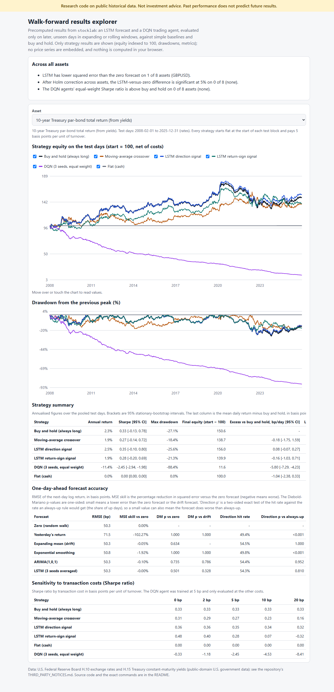
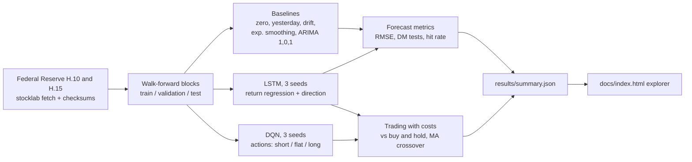

> **Research code on public historical data. Not investment advice, not a trading system, and nothing here predicts future returns. Simulated trading ignores market impact, taxes, financing and liquidity. Past performance does not predict future results.**

# stocklab: walk-forward LSTM forecasting and DQN trading, tested against honest baselines

[](https://creativecommons.org/licenses/by-nc-nd/4.0/)

## Summary

| | |
|---|---|
| **Question** | Does a small LSTM forecast next-day returns better than a zero forecast, a drift forecast and ARIMA, and does a DQN agent beat buy and hold after transaction costs? |
| **Data** | Daily series, 2000 to 2025, all public-domain U.S. government data from the Federal Reserve Board: six exchange rates (EUR/USD, USD/JPY, GBP/USD, USD/CAD, AUD/USD, USD/CHF; release H.10) and two Treasury par-bond total-return series built from H.15 constant-maturity yields (2-year and 10-year). Downloaded at run time and checked against committed checksums. Licence evidence is quoted in [THIRD_PARTY_NOTICES.md](THIRD_PARTY_NOTICES.md). |
| **Protocol** | Expanding-window walk-forward: 9 or 10 chronological test blocks of 500 days per asset (about 4,480 to 4,500 pooled test days, 2008 to 2025), models fitted only on earlier data, a validation window before each block, 3 seeds, block-bootstrap confidence intervals, Diebold-Mariano tests with Holm correction across assets. |
| **Forecasting result** | The LSTM's squared-error gain over the zero forecast ranges from -0.25% to +0.02% across the 8 assets. It is better than zero on 1 of 8 (GBP/USD, +0.02%, p = 0.39) and **none is significant**; the smallest raw Diebold-Mariano p-value is 0.39 and every Holm-adjusted p-value is 1.00. ARIMA is no better (best +0.03%, GBP/USD) and the drift forecast is never better than zero. |
| **Trading result** | The DQN agent's equal-weight Sharpe ratio at 5 bp per unit of turnover is between -2.45 and -1.06, **below buy and hold on all 8 assets**, and its daily excess return over buy and hold has a 95% interval entirely below zero on all 8. Even at 0 bp its Sharpe is between -0.34 and 0.84. |
| **What the LSTM signal does** | On both Treasury series its direction signal is long on 100% of days, so it is buy and hold there. On the six FX pairs it never beats buy and hold, and for EUR/USD and USD/JPY the paired interval is below zero. |
| **Verified by** | 108 tests (101 run in CI), ruff clean, committed run logs and raw outputs in [`results/`](results/) and [`docs/runs/`](docs/runs/). |

These are negative results, reported as measured. They describe one small LSTM, one small DQN and these eight series, not forecasting or reinforcement learning in general.

## Key figure

The static explorer (`docs/index.html`, precomputed data, no server) lets you pick an asset and compare each strategy's equity (start = 100, net of costs), its drawdown, accuracy metrics and sensitivity to costs. It shows only strategy results: no price or return series of the underlying assets are embedded, and the buy-and-hold line is simply that strategy's indexed equity. Below, the 10-year Treasury par-bond series at 1280 px; the screenshot at 390 px is [`docs/explorer-390.png`](docs/explorer-390.png).



## Problem statement

Many published stock-prediction demos report a low error or a high accuracy on a random split, which leaks the future into training, or a profitable backtest with no costs and no baseline. This project asks the plain question under a strict protocol: on days the model has never seen, does it beat the simplest alternatives, and is the difference larger than chance?

## Approach



- **Forecast target:** the next-day log return. Sample *i* uses days *i* to *i+19* and the label is day *i+20*, so no feature row contains the label day or anything after it.
- **Walk-forward:** the first block tests samples 2,000 to 2,499 (about 8 years of history), the next 2,500 to 2,999, and so on; the last block is partial. For each block the model may use everything before it; the 250 samples right before the block are held out for early stopping and the rest is training data. Inputs are standardised with training statistics only.
- **Baselines:** zero forecast (random walk on the price level), yesterday's return, expanding mean (drift), exponential smoothing with the smoothing constant picked on pre-test data, and ARIMA(1,0,1) on returns with parameters fitted once on the data before each block and then frozen.
- **LSTM:** 1 layer, 32 hidden units, dropout 0.1, 20-day window; one network regresses the return and one classifies the direction; Adam, early stopping on the validation window; seeds 0, 1 and 2 are averaged. Single CPU thread.
- **Trading environment** (`TradingEnv`, Gymnasium API): at the close of day *t* the agent sees the last 20 returns and its position, picks short, flat or long, holds it over day *t+1*, and pays 2 bp commission plus 3 bp slippage (5 bp) per unit of turnover. Every block starts flat. The same accounting (`simulate_positions`) prices the rule-based and LSTM strategies.
- **DQN:** double-DQN target, two hidden layers of 64, epsilon-greedy, trained on a rolling window of the 1,500 days before the validation window for 20 passes; the weights with the best validation Sharpe are kept; the test block is never touched. Three seeds; the "ensemble" is an equal-weight portfolio of the three agents' returns.
- **Treasury series:** a yield is not a price, so each day a constant-maturity par bond is revalued (coupon = yesterday's yield, same maturity, repriced at today's yield) and earns one day of coupon carry (`src/stocklab/rates.py`). It is an approximation, not a published index.
- **Statistics:** mean differences use the Politis-Romano stationary bootstrap (mean block length 10); Sharpe intervals use the same bootstrap; the Diebold-Mariano test is one-sided on squared error with a Newey-West variance and the Harvey-Leybourne-Newbold correction; Holm correction is applied across the 8 assets for the LSTM versus zero test.

## Data

| Asset | Series (Federal Reserve Data Download Program) |
|---|---|
| EURUSD, GBPUSD, AUDUSD (USD per unit of foreign currency); USDJPY, USDCAD, USDCHF (foreign currency per USD) | H.10 daily noon buying rates in New York: `RXI$US_N.B.EU`, `RXI$US_N.B.UK`, `RXI$US_N.B.AL`, `RXI_N.B.JA`, `RXI_N.B.CA`, `RXI_N.B.SZ` |
| UST2Y, UST10Y | H.15 Treasury constant-maturity yields `RIFLGFCY02_N.B` and `RIFLGFCY10_N.B`, converted to par-bond total-return indices |

2000-01-03 to 2025-12-31, 6,501 to 6,518 days per asset. `data/manifest.json` holds the SHA-256 of each processed series; `stocklab fetch` fails if the upstream data no longer matches. Raw and processed data are not committed. The licence of each series was checked at source and the evidence is in [THIRD_PARTY_NOTICES.md](THIRD_PARTY_NOTICES.md), together with the series that were considered and left out (Fama-French data, S&P and other index series, and EIA oil and gas prices, whose source EIA gives as a commercial vendor). The exchange rates and yields are not tradable products, so the simulated costs are an assumption and not a market quote.

## Results

All numbers below are generated from `results/summary.json` by `stocklab report` (`results/tables.md`) after the runs logged in [`docs/runs/2026-10-15-experiments.md`](docs/runs/2026-10-15-experiments.md) (2026-10-15, seeds 0, 1, 2; the forecast run took 243 s and the DQN run 739 s on 16 logical CPUs with 6 worker processes). Test days are pooled over 9 or 10 walk-forward blocks per asset, from 2008 to 2025-12-31.

### Forecasting: next-day log return, pooled walk-forward test days

| Asset | Test days | LSTM RMSE skill vs zero | LSTM DM p vs zero (Holm) | LSTM DM p vs drift | ARIMA skill vs zero | Drift skill vs zero | LSTM direction hit rate | Share of up days |
|---|---|---|---|---|---|---|---|---|
| EURUSD | 4497 | -0.11% | 0.911 (1.000) | 0.760 | -0.09% | -0.08% | 50.2% | 49.4% |
| USDJPY | 4497 | -0.05% | 0.673 (1.000) | 0.629 | -0.02% | -0.01% | 51.4% | 51.2% |
| GBPUSD | 4497 | 0.02% | 0.392 (1.000) | 0.222 | 0.03% | -0.04% | 49.0% | 50.0% |
| USDCAD | 4497 | -0.12% | 0.972 (1.000) | 0.903 | -0.09% | -0.08% | 49.0% | 50.1% |
| AUDUSD | 4497 | -0.21% | 0.908 (1.000) | 0.867 | -0.61% | -0.05% | 49.7% | 50.4% |
| USDCHF | 4497 | -0.16% | 0.883 (1.000) | 0.866 | -0.22% | -0.03% | 49.7% | 50.3% |
| UST2Y | 4480 | -0.25% | 0.755 (1.000) | 0.585 | -0.51% | -0.22% | 59.2% | 59.2% |
| UST10Y | 4480 | -0.00% | 0.501 (1.000) | 0.328 | -0.10% | -0.05% | 54.3% | 54.5% |

### Trading at 5 bp per unit of turnover: Sharpe ratio [95% bootstrap CI], pooled test days

| Asset | buy_and_hold | ma_crossover | lstm_direction | lstm_return_sign | dqn_ensemble |
|---|---|---|---|---|---|
| EURUSD | -0.10 [-0.57, 0.40] | 0.10 [-0.40, 0.50] | -0.99 [-1.40, -0.54] | -0.26 [-0.73, 0.23] | -1.71 [-2.18, -1.24] |
| USDJPY | 0.25 [-0.16, 0.67] | 0.19 [-0.30, 0.66] | -0.71 [-1.20, -0.31] | -0.32 [-0.80, 0.14] | -1.27 [-1.79, -0.79] |
| GBPUSD | -0.17 [-0.59, 0.31] | 0.24 [-0.21, 0.60] | -0.59 [-1.03, -0.18] | -0.67 [-1.12, -0.17] | -1.96 [-2.44, -1.50] |
| USDCAD | 0.23 [-0.18, 0.63] | -0.05 [-0.51, 0.40] | -0.32 [-0.71, 0.10] | -0.67 [-1.11, -0.19] | -1.87 [-2.32, -1.45] |
| AUDUSD | -0.06 [-0.48, 0.33] | -0.03 [-0.48, 0.37] | -0.07 [-0.47, 0.40] | -0.53 [-0.96, -0.08] | -1.31 [-1.78, -0.89] |
| USDCHF | -0.13 [-0.59, 0.32] | -0.20 [-0.67, 0.31] | -0.64 [-1.06, -0.22] | -0.13 [-0.55, 0.27] | -1.06 [-1.55, -0.51] |
| UST2Y | 0.93 [0.49, 1.32] | 0.68 [0.17, 1.08] | 0.84 [0.40, 1.26] | 0.80 [0.33, 1.26] | -1.93 [-2.36, -1.47] |
| UST10Y | 0.33 [-0.13, 0.78] | 0.27 [-0.14, 0.72] | 0.35 [-0.10, 0.80] | 0.28 [-0.20, 0.69] | -2.45 [-2.94, -1.98] |

### DQN (3 seeds, equal weight): Sharpe ratio by cost in bp, and trading behaviour

| Asset | 0 bp | 2 bp | 5 bp | 10 bp | 20 bp | Turnover per day | Days long | Days short |
|---|---|---|---|---|---|---|---|---|
| EURUSD | -0.06 | -0.72 | -1.71 | -3.33 | -6.43 | 0.76 | 40% | 45% |
| USDJPY | 0.37 | -0.29 | -1.27 | -2.89 | -6.01 | 0.83 | 44% | 43% |
| GBPUSD | -0.34 | -0.99 | -1.96 | -3.56 | -6.61 | 0.79 | 42% | 46% |
| USDCAD | -0.10 | -0.81 | -1.87 | -3.62 | -6.91 | 0.78 | 40% | 43% |
| AUDUSD | -0.13 | -0.60 | -1.31 | -2.48 | -4.76 | 0.81 | 42% | 44% |
| USDCHF | 0.54 | -0.11 | -1.06 | -2.65 | -5.69 | 0.82 | 46% | 40% |
| UST2Y | 0.84 | -0.29 | -1.93 | -4.27 | -7.15 | 0.25 | 69% | 23% |
| UST10Y | -0.33 | -1.18 | -2.45 | -4.53 | -8.41 | 0.83 | 46% | 40% |

### Paired comparison with buy and hold: mean daily excess return in bp [95% CI]

| Asset | ma_crossover | lstm_direction | lstm_return_sign | dqn_ensemble |
|---|---|---|---|---|
| EURUSD | 0.70 [-2.04, 3.20] | -3.23 [-5.29, -1.41] | -0.58 [-2.15, 0.93] | -3.57 [-5.68, -1.62] |
| USDJPY | -0.23 [-2.60, 2.15] | -3.87 [-6.19, -1.23] | -2.28 [-4.47, -0.16] | -4.24 [-6.40, -1.95] |
| GBPUSD | 1.58 [-1.39, 4.39] | -1.65 [-3.37, 0.09] | -1.95 [-4.41, 0.62] | -4.13 [-6.20, -2.11] |
| USDCAD | -0.97 [-2.87, 0.89] | -1.94 [-5.06, 1.04] | -3.17 [-5.96, -0.21] | -4.92 [-6.93, -2.93] |
| AUDUSD | 0.15 [-3.58, 3.61] | -0.03 [-0.94, 0.88] | -2.35 [-4.95, 0.10] | -4.16 [-6.66, -1.55] |
| USDCHF | -0.27 [-2.85, 2.26] | -2.07 [-5.00, 0.62] | 0.01 [-3.10, 2.67] | -2.20 [-4.26, -0.16] |
| UST2Y | -0.15 [-0.44, 0.15] | -0.06 [-0.15, 0.01] | -0.08 [-0.23, 0.01] | -1.45 [-1.75, -1.14] |
| UST10Y | -0.18 [-1.75, 1.59] | 0.08 [-0.07, 0.27] | -0.16 [-1.03, 0.71] | -5.80 [-7.29, -4.23] |

Reading the tables:

- A skill of -0.1% means the squared error is 0.1% higher than the zero forecast's. Daily returns are mostly noise, and the zero forecast is a strong benchmark; the LSTM, ARIMA, exponential smoothing and drift forecast all fail to improve on it in a statistically meaningful way. The only positive LSTM skill (GBP/USD, +0.02%) is 2 parts in 10,000 and not significant (p = 0.39).
- The LSTM's direction hit rate is about 50% on the FX pairs. On the Treasury series it equals the share of up days (59% and 54%), that is, it learned to say "up".
- The Treasury strategies score well because falling yields over the test period favoured long positions: buy and hold on the 2-year series has a Sharpe ratio of 0.93 [0.49, 1.32]. The LSTM direction signal and the moving-average rule do not beat it (paired intervals include zero); the DQN does much worse.
- The DQN trades heavily (turnover of 0.25 to 0.83 per day, one third of that on the 2-year series) and its gross-of-cost performance is modest or negative, so costs decide the result. Per-seed Sharpe ratios at 5 bp are all negative (listed in the run log).
- Intervals are for the pooled test period, which contains a few regimes (2008, 2020, the 2022 rate rises); they say nothing about other periods.

## Tech stack

Python 3.11, NumPy, pandas, SciPy, statsmodels, PyTorch (CPU), Gymnasium, pytest, ruff, GitHub Actions. The explorer is a single HTML file with inline JavaScript and SVG, with no external requests.

## Getting started

Prerequisites: Python 3.11 (verified on 3.11.9), about 2 GB of disk for the CPU build of PyTorch, internet access for `stocklab fetch`. No GPU is needed or used.

```bash
git clone https://github.com/Janeferdinant/stock-forecasting-lstm-rl.git
cd stock-forecasting-lstm-rl
python -m venv .venv
source .venv/bin/activate        # Windows: .venv\Scripts\activate
pip install -r requirements-dev.txt --extra-index-url https://download.pytorch.org/whl/cpu
pip install -e . --no-deps
ruff check .
pytest -q
stocklab fetch
stocklab report
python -m http.server 8000 --directory docs
```

Expected output: `All checks passed!`, `108 passed`, a JSON listing of eight assets with row counts and checksums (the command exits with an error if a checksum differs from `data/manifest.json`), the aggregate summary of the committed raw results, then the explorer at http://localhost:8000. `stocklab report` re-computes every table from the committed raw predictions in `results/raw/` and rewrites `results/summary.json`, `results/tables.md` and `docs/data.json` (identical to the committed files).

To re-run the experiments (long, CPU only; the numbers above came from these exact commands):

```bash
stocklab forecast --jobs 6      # about 4 to 10 minutes with 6 worker processes
stocklab trade --jobs 6         # about 12 to 18 minutes
stocklab report
```

For a one-minute end-to-end check of the pipeline (EURUSD, last two test blocks, one seed, a few epochs; its numbers mean nothing):

```bash
stocklab forecast --smoke --jobs 2 --raw-dir results/smoke_raw
stocklab trade --smoke --jobs 2 --raw-dir results/smoke_raw
stocklab report --raw-dir results/smoke_raw --out results/smoke_summary.json --explorer results/smoke_data.json
```

The training uses one CPU thread per process, so repeated runs give the same predictions on the same machine; results can differ slightly across machines and library versions. `make install lint test-fast forecast trade report smoke explorer` wrap the same commands.

## Project structure

```
src/stocklab/data_sources.py    asset registry, Federal Reserve file parser, checksums, processed-series loader
src/stocklab/rates.py           par-bond total return from Treasury yields
src/stocklab/fetch.py           download with retries, build, verify against data/manifest.json
src/stocklab/features.py        supervised windows with a strict next-day label, train-only scaling
src/stocklab/splits.py          walk-forward fold generator
src/stocklab/baselines.py       zero, yesterday, drift, exponential smoothing, ARIMA
src/stocklab/lstm.py            LSTM regressor and direction classifier
src/stocklab/env.py             Gymnasium trading environment with costs
src/stocklab/dqn.py             double-DQN agent
src/stocklab/strategies.py      buy and hold, moving-average crossover
src/stocklab/metrics.py         Sharpe, drawdown, RMSE, skill, directional accuracy
src/stocklab/stats.py           block bootstrap, Diebold-Mariano, binomial, Holm
src/stocklab/experiments.py     one test block of each experiment (parallelised by the CLI)
src/stocklab/analysis.py        tables, intervals, tests and thinned strategy curves from raw outputs
src/stocklab/report.py          summary.json, tables.md and explorer data
src/stocklab/cli.py             stocklab fetch | forecast | trade | report
tests/                          108 pytest tests (7 train tiny networks and are excluded from CI)
data/manifest.json              checksums of the processed series
results/                        raw predictions (float32 npz), summary.json, tables.md, logs
docs/index.html, docs/data.json the static explorer and its precomputed strategy curves and metrics
docs/runs/                      dated run logs
.github/workflows/ci.yml        ruff and the fast tests
```

## Real-world applications

The same protocol applies when a team must decide whether a forecasting model or a trading rule is worth deploying: compare against zero, drift and ARIMA on days after the training data, test the difference with an interval or a Diebold-Mariano test, include costs, and correct for the number of assets or models tried. The environment and the statistics modules can be reused for other single-asset series.

## Limitations

- **What this shows is narrow.** One small LSTM (32 units, 20-day window, one feature: past returns), one small DQN and eight series. A negative result here does not show that no model can forecast returns; it shows that these models, as configured, did not beat simple baselines. Hyper-parameters were not tuned.
- **One feature.** The inputs are only past returns. No volume, volatility, macro or cross-asset information, no alternative targets, no longer windows.
- **Rates and exchange rates, not instruments.** The FX series are noon buying rates and the Treasury series are constructed from yields; none can be traded exactly. A cost of 5 bp per unit of turnover is an assumption applied equally to all assets; real costs differ, and there is no borrowing cost for shorts, no carry on FX positions (interest-rate differentials), no leverage limits and no market impact. The Treasury par-bond return ignores roll-down and the difference between the constant-maturity bond and tradable securities.
- **No equities or commodities.** Equity indices and oil and gas prices were left out because their licence status was restricted or unclear (see THIRD_PARTY_NOTICES.md), so the study covers only FX and Treasuries.
- **Timing.** Noon buying rates in New York and Treasury yields are observed at different times of day, so the "day" is not the same across assets.
- **Pooled test period.** About 18 years including a few regimes. Intervals use a stationary bootstrap with a mean block length of 10 days; heavy-tailed or regime-dependent behaviour is not fully captured. The Diebold-Mariano tests are one-sided; the reported p-values are corrected beyond Holm across assets only for the main LSTM test.
- **DQN is sensitive and noisy.** Three seeds, a rolling 1,500-day window, 20 passes, reward equal to the cost-adjusted daily return. The ensemble is an equal-weight portfolio of agents, not a single policy.
- **Data revisions.** Upstream files can change; the checksum check detects a changed series and stops.
- **Reproducibility.** Outputs are deterministic on one machine (single-threaded training, fixed seeds) but PyTorch results can differ across CPUs and versions.
- The explorer data contains strategy equity curves and drawdowns (thinned to every fifth day) and summary metrics only. The buy-and-hold curve is the indexed performance of an always-long position in the asset.

## What I would do next

- Add features (volatility, carry, cross-asset returns) and longer windows, and tune the LSTM on validation data only, reporting how many configurations were tried.
- Replace the single-asset DQN with a policy-gradient or a distributional agent and a reward with a turnover penalty, and test whether lower turnover changes the cost result.
- Add a model-confidence-set or reality-check test across all strategies, and more assets and periods, to separate regimes from noise.
- Add FX carry and Treasury roll-down to the accounting, and extend to equities and commodities if a clearly licensed public-domain source is found.
- Add rolling (not only expanding) forecasting windows and report both.

## Credits & citation

Data: Board of Governors of the Federal Reserve System (U.S.), Data Download Program, releases H.10 and H.15; Treasury yields from the U.S. Department of the Treasury (see [THIRD_PARTY_NOTICES.md](THIRD_PARTY_NOTICES.md)). Methods: Diebold and Mariano (1995), "Comparing predictive accuracy"; Harvey, Leybourne and Newbold (1997) small-sample correction; Politis and Romano (1994), "The stationary bootstrap"; Holm (1979); Mnih et al. (2015) and van Hasselt et al. (2016) for DQN and the double-DQN target; Hochreiter and Schmidhuber (1997) for the LSTM. Please cite the repository if you use it.

## License

Original work (c) Jane Rose Ferdinant, licensed CC BY-NC-ND 4.0. Third-party data and software keep their own terms; see THIRD_PARTY_NOTICES.md.

## Author

Jane Rose Ferdinant, [portfolio](https://janeferdinant.vercel.app) · [LinkedIn](https://www.linkedin.com/in/janerosenf/)
